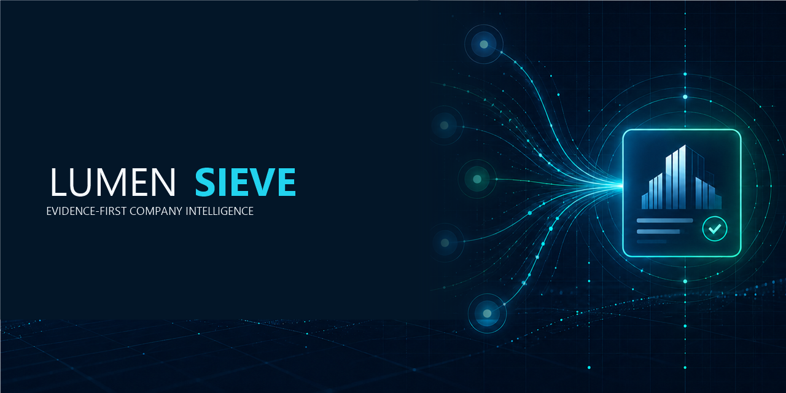
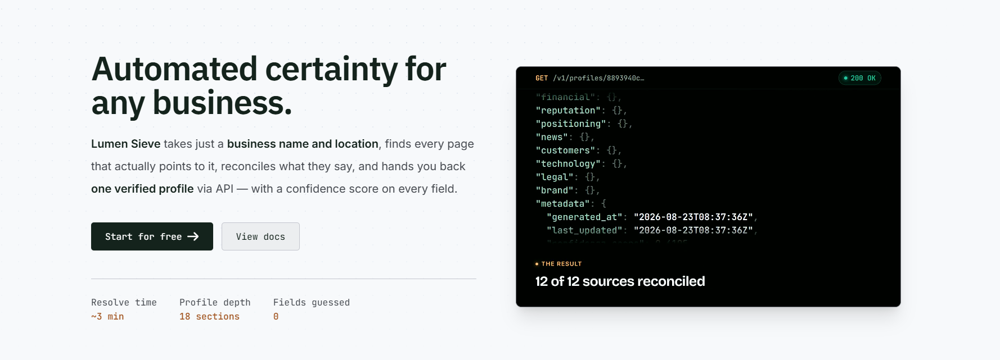
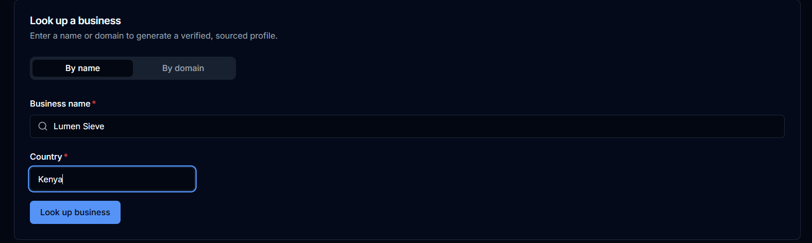
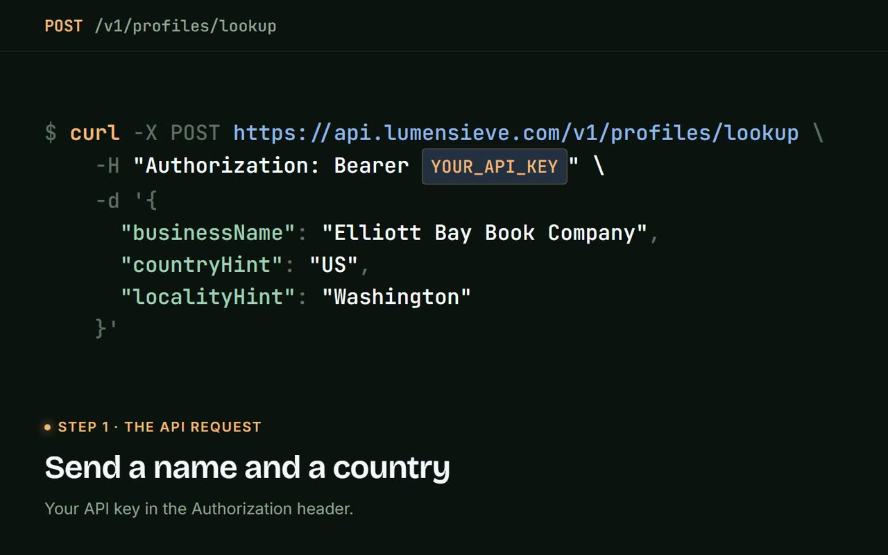
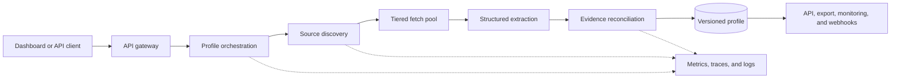

# LUMEN Sieve



**Evidence-first company intelligence that turns a business name or domain into a structured profile with field-level confidence and source attribution.**

[](https://github.com/aderofrank402-spec/lumen-sieve/actions/workflows/showcase-validation.yml)
[](https://lumensieve.com)
[](#source-boundary)
[](#engineering-case-study)

[Try the live product](https://lumensieve.com) · [Read the architecture](docs/ARCHITECTURE.md) · [Follow the data flow](docs/PRODUCT_FLOW.md) · [Contact](https://lumensieve.com/contact)

> This repository is a public engineering case study. The production source code remains private. This repository contains documentation and validation tooling—not proprietary application source, prompts, credentials, customer data, or deployment configuration.

## Product preview

[](https://lumensieve.com)

*The live homepage presents the core workflow: submit a business name and location, reconcile evidence from discovered sources, and return a structured profile with field-level confidence.*

### Start a lookup



*The authenticated lookup form accepts either a business name plus country or a company domain before starting profile resolution.*

### API flow demonstration

[](assets/demo/api-demo.mp4)

**[Watch the 38-second silent demonstration](assets/demo/api-demo.mp4)**

*Captured from the live homepage, the demonstration follows a production lookup from `POST /v1/profiles/lookup`, through asynchronous processing, to a reconciled profile returned by `GET /v1/profiles/{id}`. The displayed authorization value is a placeholder, not a credential.*

## What the product does

LUMEN Sieve accepts a company name or domain, discovers relevant public sources, fetches and extracts business evidence, resolves identity, reconciles conflicting field values, and returns a profile that keeps confidence and attribution attached to the claims it presents.

The implemented product surface includes:

- authenticated company and domain lookup;
- streaming lookup progress for the public demonstration flow;
- profile retrieval, history, refresh, batch lookup, and structured export;
- field-level confidence and source attribution;
- source-aware reconciliation with an explicit no-evidence outcome;
- profile monitoring and change notifications;
- API keys, scoped access, usage views, billing, and webhooks;
- customer, administrator, audit, and observability interfaces.

These capabilities are grounded in the private repository's API routes, protocol contracts, service implementations, UI routes, and tests. They are not a roadmap list.

## Why evidence-first matters

A polished company record can still be wrong. Business information is copied across sites, updated at different times, and often attached to similarly named organizations. LUMEN Sieve treats each field as a claim that must carry evidence—not as an unquestioned provider response.

The reconciliation path weighs source type, identity match, freshness, extraction confidence, and agreement between independent sources. When deterministic rules cannot justify a winner, the pipeline can preserve the conflict or return an honest unresolved result instead of silently manufacturing certainty.

## Engineering case study

| Concern | Implemented approach |
| --- | --- |
| Identity | Candidate discovery and identity-match signals reduce namesake contamination. |
| Retrieval | A tiered fetch path separates direct retrieval from browser-backed escalation. |
| Extraction | Structured extraction keeps field confidence and source context attached. |
| Reconciliation | Field-specific rules, credibility weighting, freshness, consensus, and bounded arbitration resolve competing values. |
| Delivery | REST, streaming progress, profile history, batch operations, exports, monitoring, and webhooks support interactive and asynchronous use. |
| Operations | Health/readiness checks, metrics, traces, logs, audit views, runbooks, and administrative controls make long-running work observable. |

The current private codebase contains **250 active test files** and **1,746 identifiable test-case declarations** across services, source discovery, shared packages, and cross-service tests. Those figures are a static repository inventory, not a claim that every test passes in every environment. This public repository validates only its own documentation and secret-safety rules.

## Architecture at a glance



See [Architecture](docs/ARCHITECTURE.md) for component boundaries and [Product flow](docs/PRODUCT_FLOW.md) for the request lifecycle.

## Representative output shape

The public example documents how a resolved field carries a value, confidence, reconciliation method, and contributing sources. It uses fictional data and does not reproduce a customer record or expose a private API response.

[View the sanitized example](docs/EXAMPLE_OUTPUT.md)

## Technology map

**Application:** Go · Python · TypeScript · Next.js · REST · gRPC · Protocol Buffers

**Data and coordination:** PostgreSQL · Redis · Elasticsearch · ClickHouse · object storage

**Operations:** Docker · Prometheus · OpenTelemetry · Jaeger · Grafana · Loki · Sentry

The technology map reflects manifests and imports in the private implementation. It does not imply that every component is required for every deployment mode.

## Verified design decisions

- Keep evidence and attribution on the field, where conflicts actually occur.
- Prefer deterministic reconciliation before bounded model-assisted arbitration.
- Separate discovery from fetching so candidate generation does not perform uncontrolled retrieval.
- Preserve an explicit `no_evidence`/unresolved path rather than forcing a value.
- Keep reconciliation traces bounded while retaining the sources and weights needed for investigation.
- Treat discovery, crawling, extraction, and reconciliation as separately observable stages.

The rationale and trade-offs are recorded in [Engineering decisions](docs/ENGINEERING_DECISIONS.md).

## Testing and validation

The private product repository contains unit, integration, end-to-end, accuracy, and service-specific test suites. This showcase deliberately does not copy private tests or implementation details.

The public workflow performs reproducible checks that are appropriate for this repository:

- required public documentation is present;
- relative Markdown links resolve;
- prohibited secret patterns are absent;
- private implementation file types are not accidentally introduced;
- the README retains the explicit private-source boundary.

Run it locally with:

```bash
python scripts/validate_showcase.py
```

## Security and privacy

This repository exposes no runnable product service and accepts no credentials. Its validation workflow is designed to fail if common private-key or credential patterns enter the public tree. The private application has a documented security-review process; this case study does not claim that an audit eliminates all risk or that every internal finding is closed.

For the exact public/private boundary and responsible-disclosure route, read [Security and privacy](docs/SECURITY_AND_PRIVACY.md).

## Limitations

- A source can be unavailable, stale, duplicated, or wrong.
- Confidence is a decision signal derived from evidence; it is not a guarantee of truth.
- A profile can remain incomplete when sufficient evidence cannot be established.
- Similarly named companies require identity evidence before their claims can be combined.
- Monitoring detects changes only in sources the system can revisit and interpret.
- This repository cannot be used to reproduce or self-host the production product.

## Source boundary

The production implementation remains private because it contains proprietary discovery, retrieval, extraction, reconciliation, operational, and deployment details. The public boundary is intentional: architecture and engineering trade-offs are inspectable here without publishing credentials, customer data, prompts, or source code.

I designed and built LUMEN Sieve across its backend services, intelligence workflows, API contracts, data model, web application, deployment, and production operations. I can discuss the system's architecture and trade-offs in an interview without disclosing private implementation.

## Documentation

- [Architecture](docs/ARCHITECTURE.md)
- [Product flow](docs/PRODUCT_FLOW.md)
- [Sanitized output example](docs/EXAMPLE_OUTPUT.md)
- [Engineering decisions](docs/ENGINEERING_DECISIONS.md)
- [Security and privacy](docs/SECURITY_AND_PRIVACY.md)
- [Changelog](CHANGELOG.md)

## Product media

The screenshots and API-flow video above are captured from the live LUMEN Sieve product and have been reviewed for public publication. Additional workflow screenshots will be added after the same privacy review. This repository does not use generated UI images or placeholder screenshots as evidence of product behavior.

## Contact

- Product: [lumensieve.com](https://lumensieve.com)
- Product contact: [lumensieve.com/contact](https://lumensieve.com/contact)
- Engineering profile: [github.com/aderofrank402-spec](https://github.com/aderofrank402-spec)
