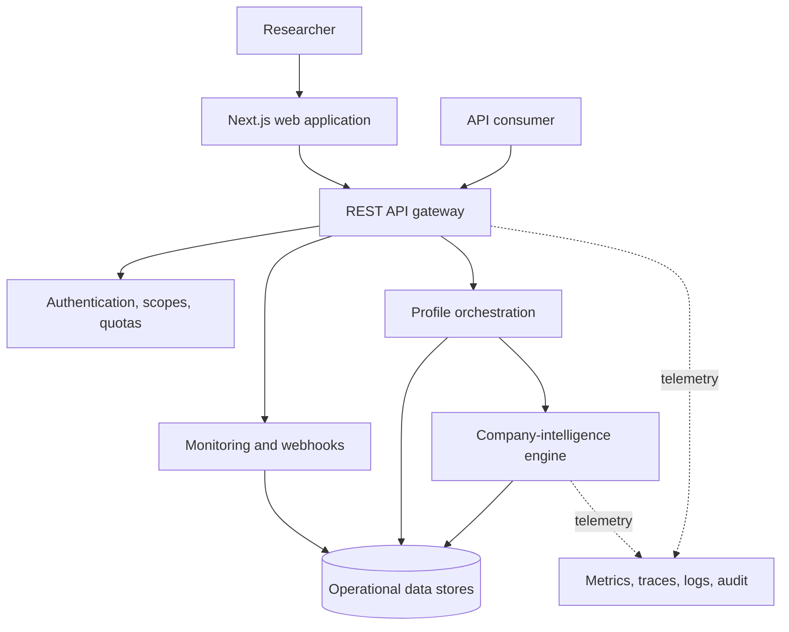
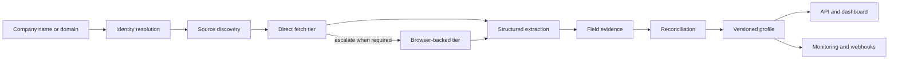
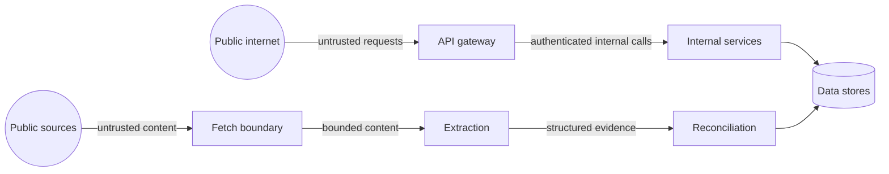

# Architecture

This document describes public-safe component boundaries verified against the private LUMEN Sieve repository. It intentionally omits credentials, hostnames, provider configuration, proprietary ranking logic, deployment topology, and customer data.

## System context

## Resolution pipeline

## Verified responsibilities

### Web application

The private application includes marketing and documentation pages, authentication, customer dashboard pages, profile views, monitoring, usage, API-key management, webhooks, billing, and separate administrative views. Next.js server routes proxy authenticated requests to the gateway rather than exposing internal services directly.

### API gateway

The gateway exposes liveness/readiness and API documentation alongside public, customer, and administrator route groups. Customer routes include profile lookup and retrieval, batch operations, version history, export, monitoring, webhooks, API keys, usage, and billing. Middleware applies authentication, scopes, request validation, idempotency where required, and rate/usage controls at the public boundary.

### Discovery and retrieval

Discovery produces candidate URLs and metadata. Retrieval is isolated behind a fetch pool, with a direct tier and browser-backed escalation path. This boundary lets candidate generation remain distinct from network retrieval and gives the system separate controls and telemetry for each stage.

### Extraction

The extraction service converts fetched content into a structured business record. Protocol contracts carry per-field confidence and source context forward instead of reducing a page to an unattributed final value.

### Reconciliation

Reconciliation operates per field. The implementation includes source-type credibility, identity-match adjustment, freshness, candidate grouping, field-specific rules, consensus, confidence calibration, validation, bounded traces, and a final bounded arbitration path for conflicts that deterministic layers cannot resolve. It also models `no_evidence` and unresolvable outcomes explicitly.

### Persistence and coordination

PostgreSQL is the primary relational store. Redis is used for cache, coordination, and queue/rate-control concerns. Search, analytics, and object-storage components appear in the private manifests for specialized workloads. This case study avoids claiming that every store participates in every request.

### Delivery and monitoring

Resolved profiles can be consumed through the dashboard and REST API, exported, monitored for change, or delivered through webhook-oriented workflows. Profile history keeps versions available for comparison.

### Observability

The repository contains health/readiness handlers, Prometheus instrumentation, OpenTelemetry integrations, tracing, log aggregation configuration, error reporting, administrative observability views, and incident runbooks. Discovery, fetching, extraction, and reconciliation are treated as distinct operational stages.

## Trust boundaries

External requests and retrieved content are separate trust boundaries. The security review in the private repository tracks controls and gaps at both boundaries; this public document does not present the existence of a control as proof that every call path is risk-free.

## What is deliberately not published

- source-selection, extraction, and reconciliation implementation;
- prompts, provider configuration, and scoring thresholds;
- production hostnames, secrets, network rules, or deployment manifests;
- customer records, traces, logs, or operational identifiers;
- exploit details or unresolved internal security findings.

