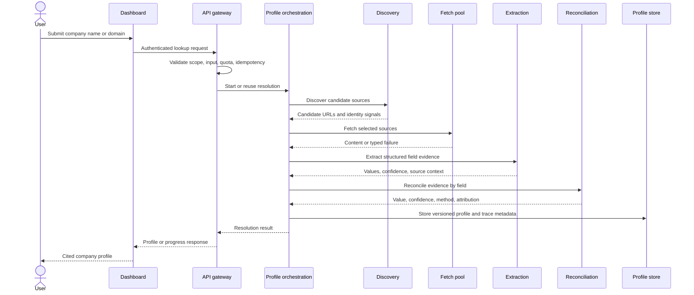
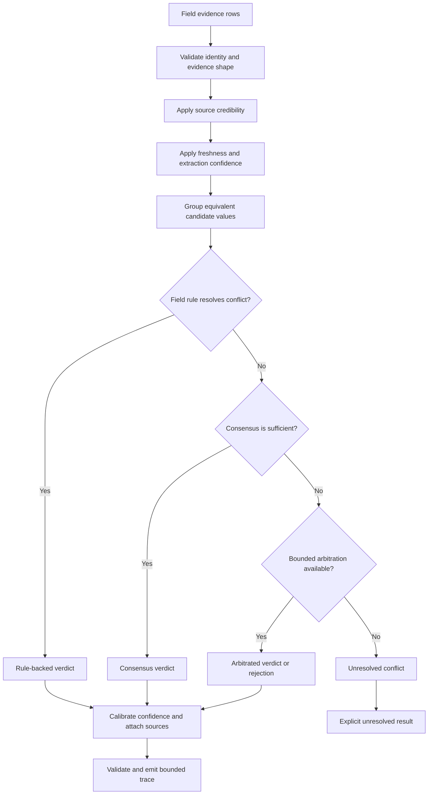

# Product flow

This lifecycle is derived from implemented routes, protocol events, services, and UI states in the private repository.

## Interactive lookup

## Field reconciliation

## Change monitoring

1. A customer creates a monitor for a resolved profile and selects a confidence threshold or notification behavior.
2. A scheduled refresh produces a new profile version.
3. Field-level changes are compared against the previous version.
4. Eligible changes are displayed in the dashboard and can enter notification or webhook delivery flows.
5. Delivery attempts and operational failures remain observable for retry and support workflows.

## Failure behavior

The pipeline can distinguish failures by stage rather than returning one generic error. Examples represented in the implementation include unavailable sources, fetch failures, extraction failures, no evidence, unresolved conflicts, quota/rate rejection, and downstream delivery failure. A failed source does not automatically imply that every independent source or the complete lookup must fail.

